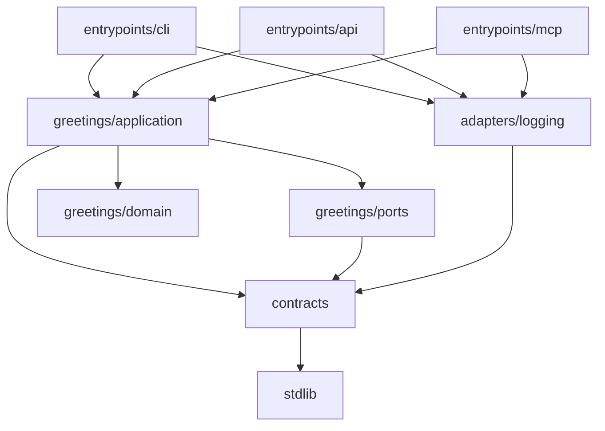

# Architettura

Il progetto è un modular monolith con una sola distribuzione Python e tre superfici di ingresso. L'architettura è deliberatamente piccola, ma i confini sono reali e verificati automaticamente.

## Stile

Il codice segue tre idee combinate:

- **Functional core, imperative shell**: il dominio è fatto di funzioni pure e value object immutabili; l'I/O e i framework vivono ai bordi.
- **Ports and adapters**: l'application layer dipende da `Protocol` espliciti; gli adapter concreti implementano le porte e vengono iniettati dai composition root.
- **Modular monolith**: un solo package importabile, con sottosistemi separati da regole di import verificate.

Il dominio non conosce Pydantic, FastAPI, MCP, argparse, structlog o il filesystem. L'application layer conosce il dominio, le porte e i contratti, ma non gli adapter o gli entrypoint.

## Diagramma delle dipendenze



Le frecce rappresentano dipendenze di import. `contracts` è una foglia e non importa altri moduli interni. Il dominio non importa nulla fuori da sé stesso.

## Struttura

```text
src/py_boilerplate/
  contracts/        # DTO Pydantic, errori, Problem Details, porta Logger
  greetings/
    domain/         # Greeting e greet, puri
    application/    # say_hello, dipendenze esplicite
    ports/          # Logger Protocol
  adapters/         # structlog
  entrypoints/
    cli/            # parsing, comando, renderer, registry, composition root
    api/            # factory FastAPI, route, error mapper, composition root
    mcp/            # factory MCPServer, tool, composition root
```

Ogni entrypoint è un adapter driving. Il composition root costruisce logger e dipendenze, invoca il caso d'uso e mappa il risultato sul canale. Nessun entrypoint importa un altro entrypoint.

## Flusso di una richiesta

Esempio API:

1. FastAPI riceve `GET /api/hello-world?name=Ada`.
2. La route costruisce `HelloWorldInput` e valida il dato a runtime.
3. In caso di errore, `to_problem_details` produce un `ProblemDetails` con status 400 e `application/problem+json`.
4. In caso di successo, `say_hello` chiama `greet` e registra l'evento tramite la porta `Logger`.
5. La route restituisce `HelloWorldOutput`, serializzato da FastAPI.

CLI e MCP seguono lo stesso schema, cambiando solo parsing, validazione del confine e rendering. La logica del caso d'uso è una sola.

## Contratti

I contratti vivono in `src/py_boilerplate/contracts/` e sono la fonte canonica per:

- input e output del caso d'uso;
- codici errore;
- mapping verso exit code, status HTTP e URN Problem Details;
- porta di logging.

I contratti usano Pydantic per la validazione runtime. Il tipo `HelloWorldName` è un alias `Annotated` riusato dalla firma del tool MCP, così i vincoli non vengono duplicati. La route HTTP valida esplicitamente con il modello invece di affidarsi al solo schema OpenAPI.

## Errori

La tassonomia è unica e stabile. `ErrorCode` è uno `StrEnum`; `AppError` è un value object immutabile; `ApplicationError` è l'eccezione tipizzata che attraversa l'application layer. I confini mappano:

- CLI: codice errore e messaggio su stderr, exit code da `ERROR_CODE_TO_EXIT_CODE`.
- API: `ProblemDetails` con URN, titolo, status e detail.
- MCP: il framework converte l'eccezione o l'errore di schema in un tool error con `isError: true`.

Le decisioni sono in [`ADR-0004`](adr/0004-tassonomia-errori.md).

## Logging

La porta `Logger` espone i cinque livelli standard. L'adapter structlog configura JSON in produzione e CI, console renderer in sviluppo. I colori ANSI sono disabilitati su stream non-TTY e con `NO_COLOR`. La configurazione avviene una sola volta per processo, nel composition root.

L'evento `saying hello` è stabile e greppabile; il nome viaggia come contesto strutturato e non contiene segreti. Nessun modulo di libreria configura logging o legge l'environment all'import.

## Configurazione

`RuntimeSettings` valida `LOG_LEVEL` e `APP_ENV` con pydantic-settings. `ApiSettings` aggiunge host e porta con bounds. La configurazione è letta solo nei composition root; i moduli interni ricevono valori già validati.

La versione di Python è pinnata in `.python-version` e le dipendenze in `uv.lock`. Il floor di environment è in `.env.default`; le variabili locali stanno in `.env` o `.envrc.local`, entrambi gitignored.

## Async e concorrenza

- Il caso d'uso e il dominio sono sincroni e veloci.
- La route FastAPI è `def`, quindi gira nel threadpool e non blocca l'event loop.
- Il server MCP usa il trasporto stdio dell'SDK, che gestisce l'event loop e i task del protocollo.
- Non esistono task `asyncio` fire-and-forget, code o worker.

Se in futuro nasce un confine realmente asincrono, deve avere ownership esplicita, timeout, cancellazione e test dedicati, come richiesto dal Vademecum.

## Testing dell'architettura

- Unit test su dominio, contratti, renderer e adapter.
- Integration test su API con `TestClient` e su MCP con trasporto in-memory.
- Contract test su processo CLI reale e sulla coerenza tra superfici.
- E2E su processi reali: CLI, API HTTP e MCP stdio.
- Import Linter verifica i confini; deptry verifica le dipendenze dichiarate.

La strategia completa è in [`docs/development/TESTING.md`](../development/TESTING.md).
